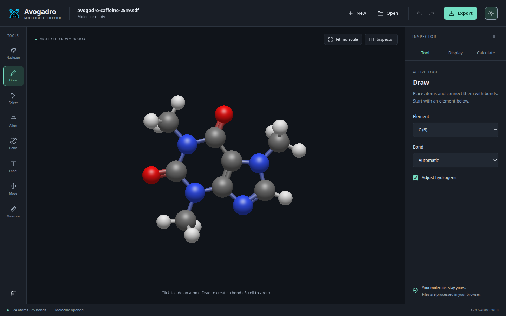

# Avogadro web editor

Draw, edit, and visualize molecules in a desktop browser with Avogadro's
WebAssembly (WASM) build. Open molecular files, optimize geometry, and display
molecular surfaces and orbitals. Files are processed in your browser.

Use the included editor, or build your own interface around the same molecular
rendering and editing runtime.



## Workspace interface

The editor opens in dark mode. The sun/moon control switches the interface and
molecular canvas between dark and light, remembering the choice in this browser.
Document actions and export are in the top bar; molecular tools are on the left.
The right inspector contains Tool, Display, and Calculate tabs. Close it for more
canvas space, or reopen it with **Inspector**. Below 1000px it becomes a drawer.
The inspector tabs support arrow keys, Home and End; Escape closes the export
popover or compact inspector. Tool buttons have labels and hover/focus tooltips.

The interface uses the capabilities advertised by its runtime. Older CI packages
with only Draw, Navigate and Select still work, but retain their fixed dark canvas
and explain unavailable display/calculation controls. Build this source with a
plugin-enabled Avogadro installation for all tools, calculations, and canvas
color switching. Theme changes never enter molecular undo history.

## Get started

1. Choose a development build.
   - [Multithreaded ZIP](https://github.com/OpenChemistry/avogadro-web/releases/download/continuous/avogadro-web-wasm.zip)
     includes geometry optimization, Auto Optimize, and surface and orbital calculations.
   - [Single-threaded ZIP](https://github.com/OpenChemistry/avogadro-web/releases/download/continuous/avogadro-web-wasm-singlethread.zip)
     opens directly from disk and supports viewing and editing in cross-origin iframes.
     The worker-based calculations listed above are unavailable in this build.

   See the [download page](https://github.com/OpenChemistry/avogadro-web/releases/tag/continuous)
   for availability and version details.
2. Extract the ZIP.
   - **Single-threaded**. Double-click `avogadro-offline.html`. You can move
     this file on its own and open it without a server or internet connection.
   - **Multithreaded**. Open a terminal in the extracted folder, run
     `python3 serve-wasm.py`, and open [http://127.0.0.1:8000/](http://127.0.0.1:8000/).
     Press Ctrl+C in the terminal to stop the server.

Both builds need a browser with WebAssembly and WebGL 2. The multithreaded
build also needs SharedArrayBuffer, which the bundled server enables on
loopback by sending cross-origin isolation headers. Enable hardware
acceleration if WebGL 2 is unavailable.

## Using the editor

The initial document is empty, with Draw active, carbon selected, automatic bond
order and hydrogen adjustment enabled. Draw by clicking or dragging; right-click
an atom or bond to remove it. Select by clicking or dragging a rectangle. Navigate
by dragging to rotate, right-dragging to pan, and scrolling to zoom. Ctrl/Cmd+Z,
Ctrl/Cmd+Shift+Z, Ctrl+Y, Delete and Backspace apply only in the viewport.

The WASM build also includes Measure, Manipulate, Align, Bond-Centric
Manipulation, and Edit Labels. Click atoms in the viewport to measure or align
them. Drag atoms with Manipulate, or pick a bond and right-drag one of its atoms
with Bond-Centric Manipulation to change its length. Edit Labels opens an HTML
input after you pick an atom. The display menu toggles Ball and Stick, Wireframe,
Licorice, Van der Waals, and Labels on the active layer. CJSON saves the enabled
styles per layer. If a file has no enabled style available in the web build,
the editor enables Ball and Stick. It also enables Crystal Lattice when the
molecule has a unit cell and Cartoons when it has residues. Open accepts PDB
files for proteins and nucleic acids.

With the multithreaded Qt WASM build, **Calculations** offers Optimize
Geometry with UFF or Lennard-Jones, three molecular surfaces, and orbital
and electron-density isosurfaces. Open a Gaussian
formatted checkpoint (.fchk) or Molden file for orbital calculations, or
a Gaussian cube (.cube) to render an imported grid. Use **Display styles**
to show or hide the resulting surface.

CJSON is the default download format. MOL, SDF and XYZ are also supported. Open
parses into a temporary document; errors preserve the molecule and undo history.
Open and New clear history on success. Multi-record SDF and XYZ imports use the
first record with a visible notice. Replacing unsaved work requires an HTML
confirmation; leaving the page also requests browser confirmation. Only a CJSON
download clears the unsaved marker because other formats may omit properties.
A download request cannot prove that the user retained the file.

In browsers with WebMCP enabled, Avogadro registers the read-only
`inspect_molecule` tool. It returns atomic numbers, bond orders with zero-based
atom indices, counts, and the unsaved status of the live molecule. Inspection
runs in the tab and leaves the editor's undo stack and unsaved status intact.

## Build an application with the WASM package

The package contains the compiled Avogadro runtime and an example HTML/JavaScript
interface. You can change the interface without rebuilding the WASM binary.
Keep the `core/` module, `avogadro-web.js`, `avogadro-web.wasm`, `qtloader.js`,
and any `.data` or worker JavaScript files from the same package together.
`build-manifest.json` identifies its build profile, source revisions, and toolchain.

Import the reusable module at `core/avogadro-editor.js`. The full editor at
`index.html` uses this same module and adds its own controls, styles, and
WebMCP integration. A custom page needs the core module, the runtime files
listed above, and a viewport with a nonzero width and height.

### Initialize a viewport

Save the following three files at the root of the unpacked WASM package.
Start `python3 serve-wasm.py` for the multithreaded package or
`python3 -m http.server --bind 127.0.0.1` for the single-threaded package and open
`http://127.0.0.1:8000/viewer.html`. See the
[self-hosting guide](docs/self-hosting.md) for other servers.

`viewer.html`

```html
<!doctype html>
<html lang="en">
<head>
  <meta charset="utf-8">
  <meta name="viewport" content="width=device-width, initial-scale=1">
  <title>Avogadro molecule viewer</title>
  <link rel="stylesheet" href="viewer.css">
</head>
<body>
  <div id="viewport" tabindex="0" aria-label="Molecule viewport"></div>
  <script src="avogadro-web.js"></script>
  <script src="qtloader.js"></script>
  <script type="module" src="viewer.js"></script>
</body>
</html>
```

`viewer.css`

```css
#viewport {
  height: 70vh;
}
```

`viewer.js`

```js
import { createAvogadroEditor } from './core/avogadro-editor.js';

const editor = await createAvogadroEditor(document.querySelector('#viewport'));
editor.loadMolecule('3\nWater\nO 0 0 0\nH 0.96 0 0\nH -0.24 0.93 0\n', 'xyz');
editor.setTool('navigate');
```

The factory checks browser support, initializes the Qt runtime, and handles
viewport resizing and wheel zoom. The optional second argument accepts
`onExit(details)`, `print(text)`, and `printErr(text)` callbacks. If you
initialize Qt yourself, wrap the instance with
`new AvogadroEditor(instance)` using the class exported by the core module.

### Control the molecule

The `AvogadroEditor` wrapper provides:

- `loadMolecule(text, format)`, `exportMolecule(format = 'cjson')`, and
  `newMolecule()` for file content and documents. Export returns text; your
  application chooses how to download or store it.
- `setTool(id)` and `setDisplayStyle(id, enabled)` for editing and rendering.
  Discover available IDs from `state.tools` and `state.displayStyles`.
- `setDrawOptions(options)` for element (`atomicNumber`), bond order,
  `adjustHydrogens`, and `adjustBondLengths`.
- `alignPickedAtoms('x' | 'y' | 'z')` and `setPickedLabel(label)` for picked atoms.
- `deleteSelection()`, `undo()`, `redo()`, and `resetCamera()`.
- `setTheme('dark' | 'light')` to change the molecular canvas theme.
- `calculate(command, options)` for calculations supported by the package.
  See the calculation controls in `editor.js` for commands and their options.
- `state` and `statechange` events for molecule counts, available tools and
  styles, selection, undo/redo availability, unsaved changes, and calculation
  progress.

The wrapper parses JSON results and raises errors for rejected operations.
Calculation completion is reported through state changes. Disable conflicting
controls while `state.calculating` is true.
Your application should handle unsaved changes before replacing a document.

## Host your application

See the [self-hosting guide](docs/self-hosting.md) for server configuration
and deployment instructions.

## Build from source

To change the C++ controller or the plugins included in the WASM runtime, see
[Building and testing](https://github.com/OpenChemistry/avogadro-web/blob/main/BUILDING.md).
